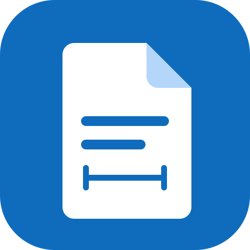
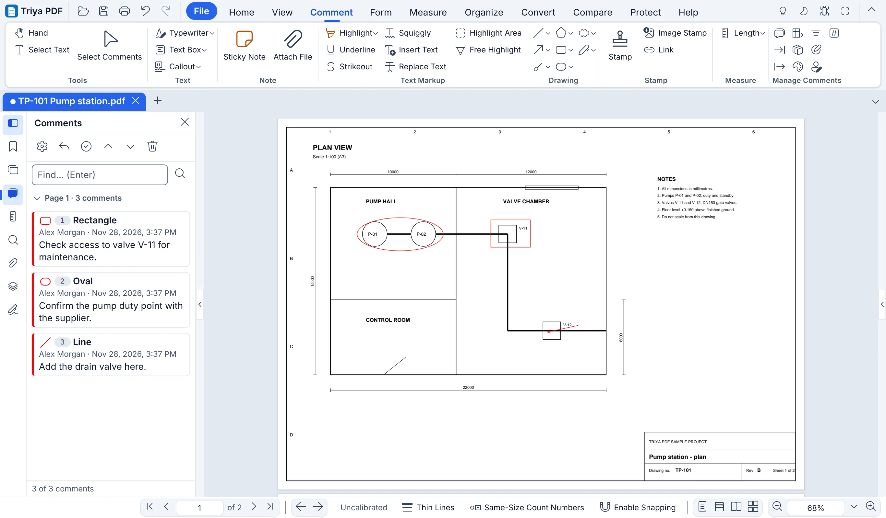
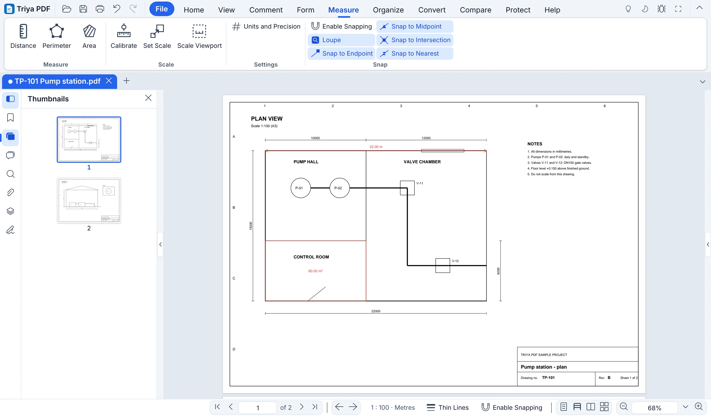
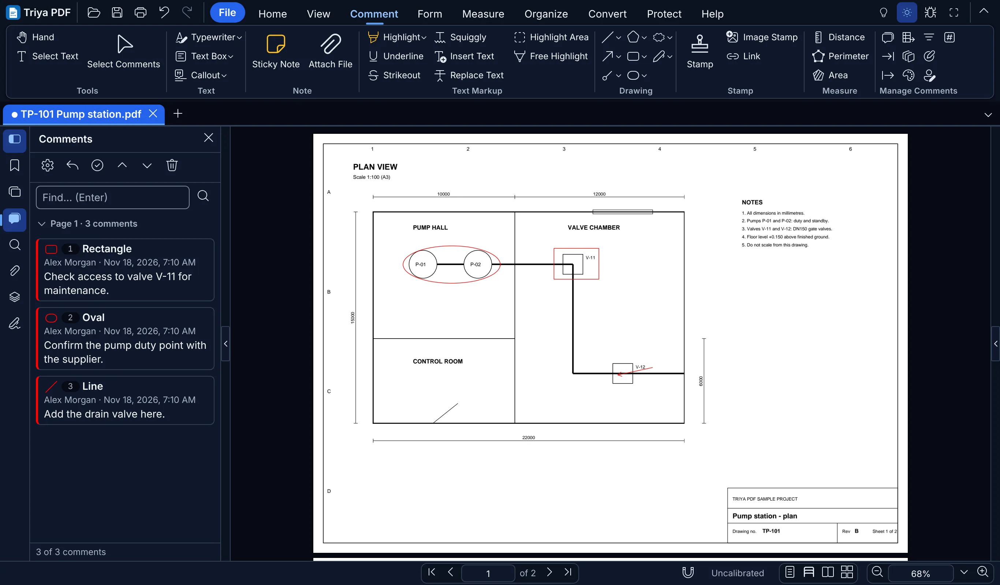
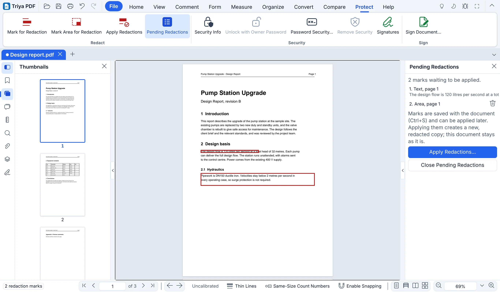
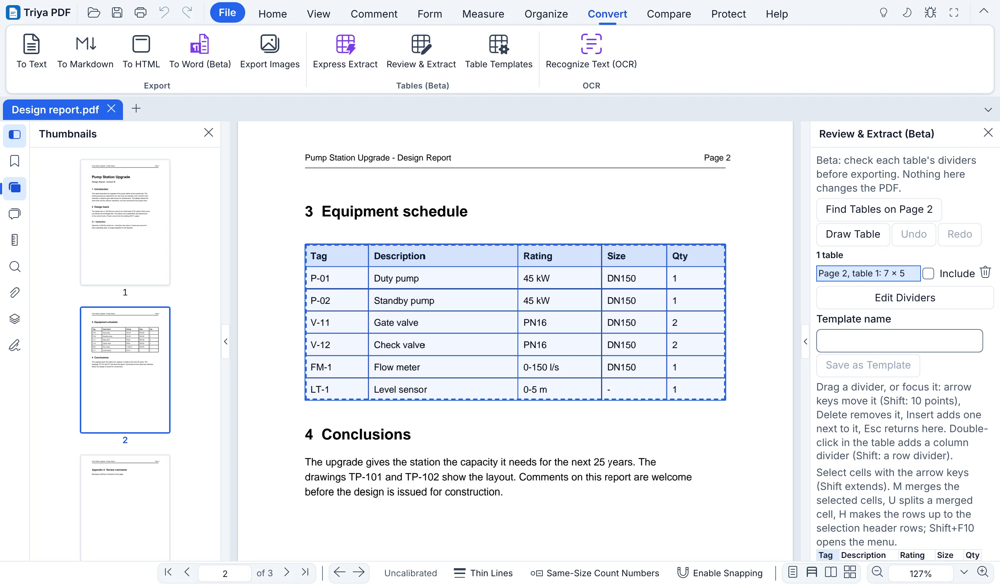

<div align="center">



# Triya PDF

**A free, offline, private PDF editor for engineers, right in your browser.**

Mark up drawings, measure to scale, fill forms, redact and organize pages. Your files never
leave your computer.

[](https://github.com/shubhs650/PDFTools/releases)
[](https://github.com/shubhs650/PDFTools/actions/workflows/ci.yml)
[](LICENSE)

**[Open Triya PDF](https://app.triyapdf.com)** · [triya-pdf.openengtools.com](https://triya-pdf.openengtools.com) · [What's new](docs/release-notes/v1.0.0.md) · [Report an issue](https://github.com/shubhs650/PDFTools/issues/new)



</div>

## Why Triya PDF

- **Private by design.** Documents are opened, rendered and saved in your browser. Nothing is
  uploaded: no account, no cookies, no analytics, no telemetry.
- **Works offline.** After the first visit the whole app, its fonts and its OCR for English are
  stored on your device. Install it and it opens like a desktop app, with or without a network.
- **Made for engineering documents.** Big drawings and long specifications stay responsive,
  because every heavy job runs in background workers. Measure to scale, snap to the drawing's
  lines, and carry comments from one revision of a drawing to the next.
- **Standard PDFs out.** Comments, form fields, bookmarks and signatures are standard PDF
  objects, so Acrobat Reader and other viewers show them. Ctrl+S saves only what changed.
- **Free and open source,** under the MIT license.

## Features

|                         |                                                                                                                                                                                                                                                                                                                   |
| ----------------------- | ----------------------------------------------------------------------------------------------------------------------------------------------------------------------------------------------------------------------------------------------------------------------------------------------------------------- |
| **View and find**       | Document tabs, thumbnails, bookmarks, layers and attachments; zoom, rotate and page layouts; Find and Advanced Search across all open files; print, or export a print-ready PDF.                                                                                                                                  |
| **Comment and mark up** | Highlight, underline, strike out, sticky notes with replies, text boxes, typewriter and callouts (with a font library that ships with the app), lines, arrows, shapes, clouds, pencil and stamps, including your own pictures. Comment styles, a Comments pane to filter and review, and status for each comment. |
| **Measure**             | Set or calibrate a scale (also per viewport), then measure distance, perimeter and area, snapping to endpoints, midpoints, intersections and the nearest line.                                                                                                                                                    |
| **Organize**            | Insert, delete, move, rotate, extract, split, crop and merge pages; turn images into a PDF; start a blank PDF.                                                                                                                                                                                                    |
| **Forms**               | Fill and save forms; create text fields, check boxes, radio buttons, lists and dropdowns.                                                                                                                                                                                                                         |
| **Convert**             | Export text, Markdown, HTML, Word and images; extract tables to Excel; recognise the text in scans (OCR) so it can be searched and selected.                                                                                                                                                                      |
| **Protect**             | Redact text and areas for good (a new, fully rewritten and verified file); add or remove a password; visual signatures; an offline integrity check of digital signatures.                                                                                                                                         |
| **Your way**            | Light and dark themes, two densities, a ribbon that adapts to the window, Tell me (Alt+Q) to find any command, full keyboard access, and Help that works offline.                                                                                                                                                 |

<table>
  <tr>
    <td width="50%"><br><b>Measure to scale</b> with snapping to the drawing.</td>
    <td width="50%"><br><b>Dark theme</b>, while pages stay white.</td>
  </tr>
  <tr>
    <td><br><b>Redact</b> text and areas, verified before it says done.</td>
    <td><br><b>Extract tables</b> to Excel, checking each one first.</td>
  </tr>
</table>

## Get started

1. Open **[app.triyapdf.com](https://app.triyapdf.com)** (or
   [triya-pdf.openengtools.com](https://triya-pdf.openengtools.com)).
2. Drop a PDF on the window, or choose **Open**.
3. To keep it like a desktop app, choose **Install** in the address bar (Chrome or Edge), and
   pin it to the taskbar or Dock. It updates itself.

Each address is its own app in your browser: settings, recent files and recovery data are kept
separately for each.

**Browsers:** Chrome and Edge on the desktop are the main targets; Firefox is supported; Safari
works on a best-effort basis. Phones and tablets are not supported.

**Help** is built in: press **F1**, or the **?** on any dialog.

## Privacy

Triya PDF loads its own program files and checks its own website for updates, and that's it.
Opening, editing, searching, OCR and saving all happen on your device. Error reports are sent
only when you choose **Help › Send Error Report**, and never include document content, file
names or screenshots. File › Privacy lists everything the app stores on your device and clears
it with one click.

## Built with

[React](https://react.dev) and TypeScript · [EmbedPDF](https://github.com/embedpdf/embed-pdf-viewer) and
[PDFium](https://pdfium.googlesource.com/pdfium/) for rendering, annotations and saving ·
[PDF Oxide](https://github.com/yfedoseev/pdf_oxide) for text and tables ·
[Tesseract](https://github.com/tesseract-ocr/tesseract) for OCR ·
[Fluent UI System Icons](https://github.com/microsoft/fluentui-system-icons) ·
[Inter](https://rsms.me/inter/) · [Vite](https://vite.dev) and a service worker for offline use.
Every package and its license is listed in **File › About**. Only permissive licenses are used.

## Development

Requires Node ≥ 22.18 (see `.nvmrc`).

```sh
npm ci
npm run dev          # Vite dev server
npm run typecheck    # tsc -b (strict)
npm run lint         # ESLint (type-aware, no hardcoded strings in the UI)
npm run format       # Prettier
npm run test         # Vitest unit tests (tests/)
npm run e2e          # Playwright end-to-end tests (e2e/); builds and serves the app
npm run perf         # Playwright performance scenarios (e2e/perf/)
npm run licenses     # Dependency license gate: fails on non-permissive licenses
npm run build        # Production build into dist/
```

If the installed Chromium doesn't match Playwright's, set `PW_CHROMIUM_EXECUTABLE=/path/to/chrome`
for `npm run e2e`. `npm run help:screenshots` and `npm run readme:screenshots` regenerate the
pictures in Help and in this README.

How it is built:

- [`ARCHITECTURE.md`](ARCHITECTURE.md) is the specification: main thread for UI only, Render and
  Work workers behind a typed RPC, incremental saves, redaction rules, and every decision (D-xx).
- [`docs/adr/`](docs/adr/) holds the architecture decision records, [`docs/plan/`](docs/plan/)
  the milestone plans and [`docs/PROGRESS.md`](docs/PROGRESS.md) the log.
- [`CLAUDE.md`](CLAUDE.md) lists the standing rules for contributors, human or AI.

## Deployment

Cloudflare Workers serve the static build and the opt-in `/api/report` endpoint. `main` deploys
the beta; a version tag (`v1.0.0`) deploys the release to both domains after approval, from
[`.github/workflows/release.yml`](.github/workflows/release.yml). Setup and rollback:
[`docs/deploy/release.md`](docs/deploy/release.md).

## Contributing

Bug reports and ideas are welcome: [open an issue](https://github.com/shubhs650/PDFTools/issues/new/choose).
Please **never attach confidential or client documents**; a self-made PDF that shows the
problem is perfect. See [CONTRIBUTING.md](CONTRIBUTING.md) before opening a pull request.

## License

[MIT](LICENSE) © 2026 shubhs650. Third-party packages keep their own licenses, listed in
File › About and in `third-party-notices.txt` in every build.
